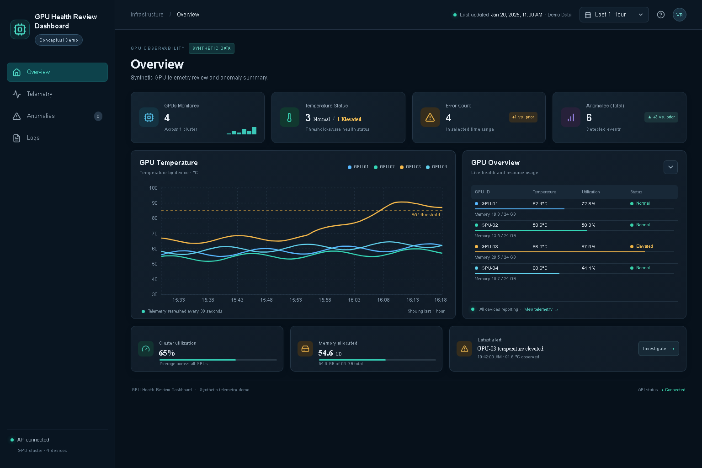
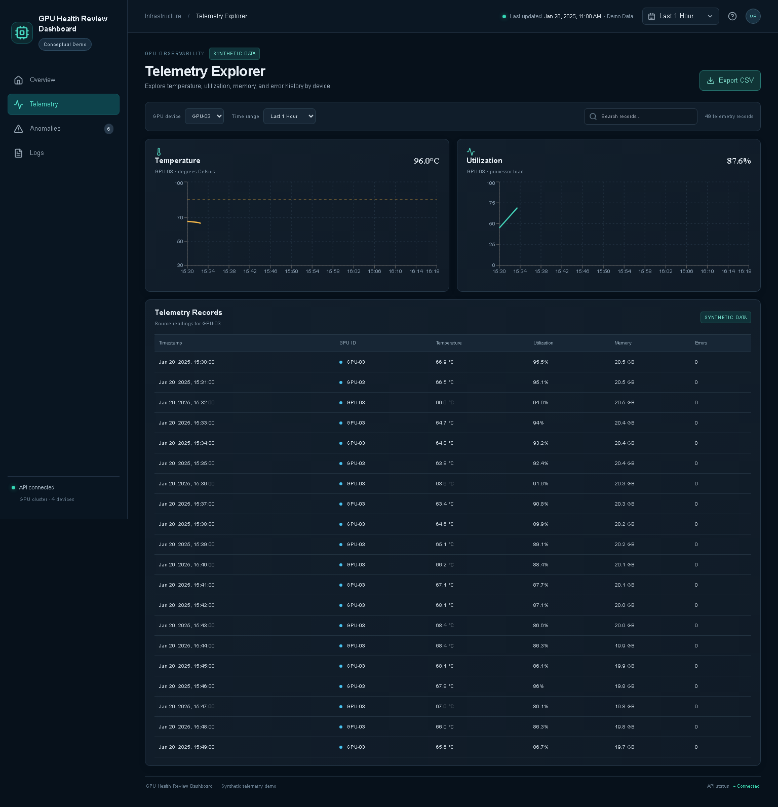
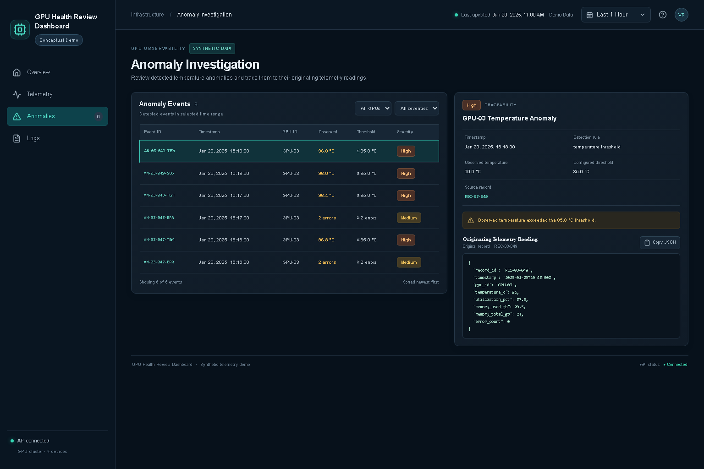
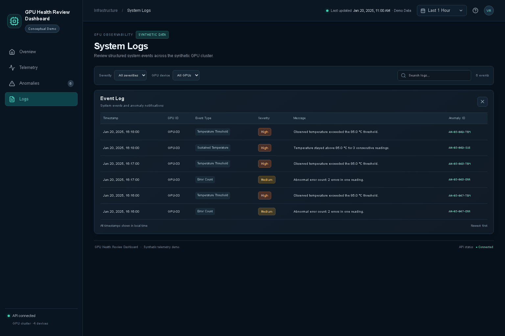

# GPU Health Review Dashboard

A portfolio-ready GPU observability demo with a dark monitoring dashboard, deterministic synthetic telemetry, and explainable anomaly alerts. It is a **synthetic-data application** and does not connect to physical GPU hardware.



## What it does

- Monitors four synthetic GPUs with temperature, utilization, memory, and error readings.
- Presents Overview, Telemetry, Anomalies, and Logs views backed by one consistent data model.
- Shows responsive temperature and utilization charts, device health, and telemetry tables.
- Filters readings and events, exports telemetry to CSV, and inspects the exact source record for an alert.
- Provides a FastAPI API with typed response models, filtering, input validation, and health/config endpoints.
- Includes deterministic rules for threshold, sustained-temperature, and error-count anomaly events.

## Screenshots

Screenshots are captured from the running application with Playwright at 1536 × 1024.

| Overview | Telemetry |
|---|---|
|  |  |

| Anomaly investigation | Logs |
|---|---|
|  |  |

## Architecture

```text
Next.js + TypeScript UI (port 3000)
  ├─ Overview / Telemetry / Anomalies / Logs
  ├─ Recharts visualizations
  └─ REST fetch → FastAPI (port 8000)
       ├─ deterministic telemetry generator (seed 2025)
       ├─ Pydantic response schemas
       └─ explainable anomaly detection + source record links
```

The browser uses the API response for device summary, telemetry, alerts, and logs. When the API is unavailable, Overview/Anomaly views provide a labeled local demo fallback so the interface remains explorable.

## Anomaly methodology

Thresholds are 75 °C for GPU-01, GPU-02, GPU-04 and 85 °C for GPU-03. A reading above its threshold creates a `temperature_threshold` event. Three consecutive above-threshold readings also create one `sustained_temperature` event per GPU series. A reading with at least two errors creates an `error_count` event.

Severity is deterministic: **Low** is below 5 °C above the configured temperature threshold; **Medium** is 5–9.9 °C above it or two errors; **High** is at least 10 °C above it or three or more errors. The API returns the full source telemetry record and its ID with each alert. This is a rules-based detector, not a trained machine-learning model.

## Run locally

Requirements: Node.js 20+, npm, and Python 3.10+.

```powershell
# From the repository root
python -m venv .venv
.\.venv\Scripts\Activate.ps1
pip install -r backend/requirements.txt

# In a second terminal
npm install
npm run dev

# In the first terminal, start the API
python -m uvicorn backend.main:app --reload --port 8000
```

Open [http://localhost:3000](http://localhost:3000). API docs are at [http://localhost:8000/docs](http://localhost:8000/docs). Copy `.env.example` to `.env.local` only if you need to change the frontend API URL.

## API

| Method | Route | Purpose |
|---|---|---|
| GET | `/api/health` | API status and synthetic mode |
| GET | `/api/gpus` | Latest health and resource use per GPU |
| GET | `/api/telemetry?gpu_id=GPU-03&limit=100` | Readings, optionally filtered by device |
| GET | `/api/telemetry/{gpu_id}` | Readings for one GPU (404 for unknown IDs) |
| GET | `/api/anomalies?severity=High&gpu_id=GPU-03` | Filtered newest-first alerts with source records |
| GET | `/api/anomalies/{anomaly_id}` | One traceable alert |
| GET | `/api/logs?gpu_id=GPU-03` | Structured event log |
| GET | `/api/summary` | GPU summary, counts, generation time |
| GET | `/api/config` | Threshold and severity rule configuration |

## Checks

```powershell
pytest backend/tests -q
npm run typecheck
npm run lint
npm run build
npx playwright install chromium
npm run test:e2e
```

The Playwright journey validates page navigation, CSV export, alert traceability controls and writes the four screenshots under `docs/screenshots/`.

## Limitations and next steps

Telemetry is generated in memory from a fixed seed and fixed demonstration interval. It is intended for UI/API evaluation and does not model vendor-specific metrics, hardware polling, persistence, authentication, or alert delivery. Useful extensions include a real collector adapter, persisted time-series storage, configurable thresholds, RBAC, and historical comparisons.
